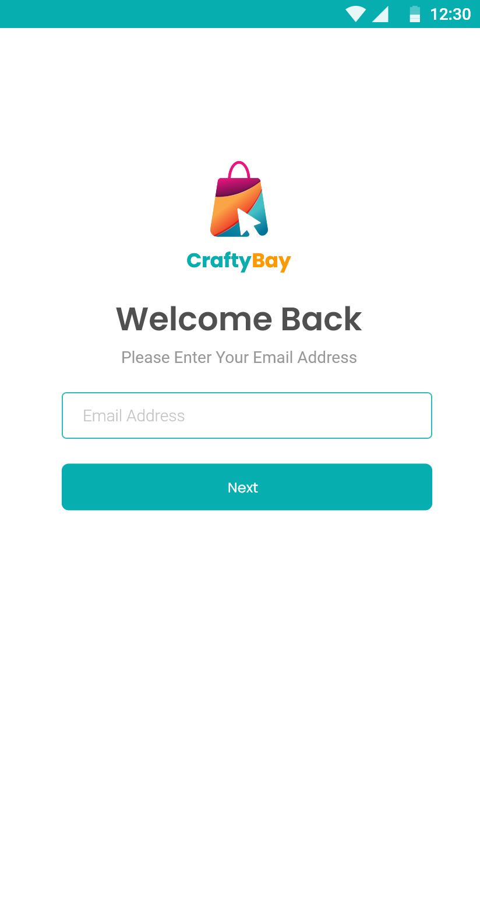
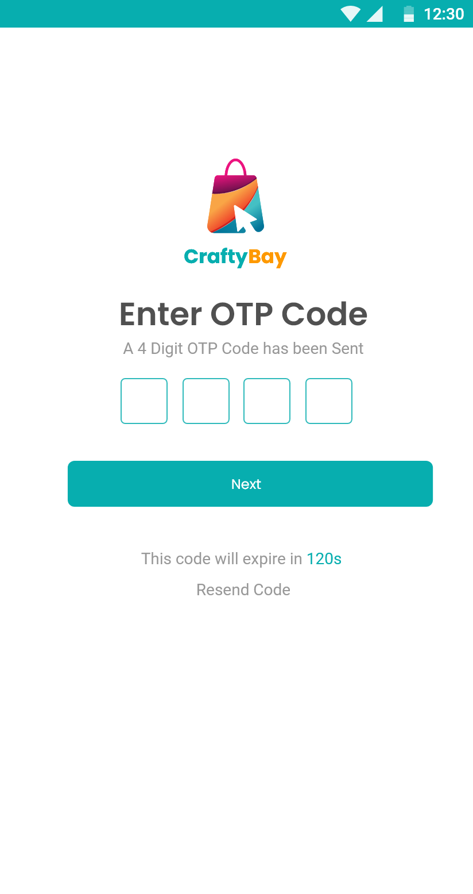
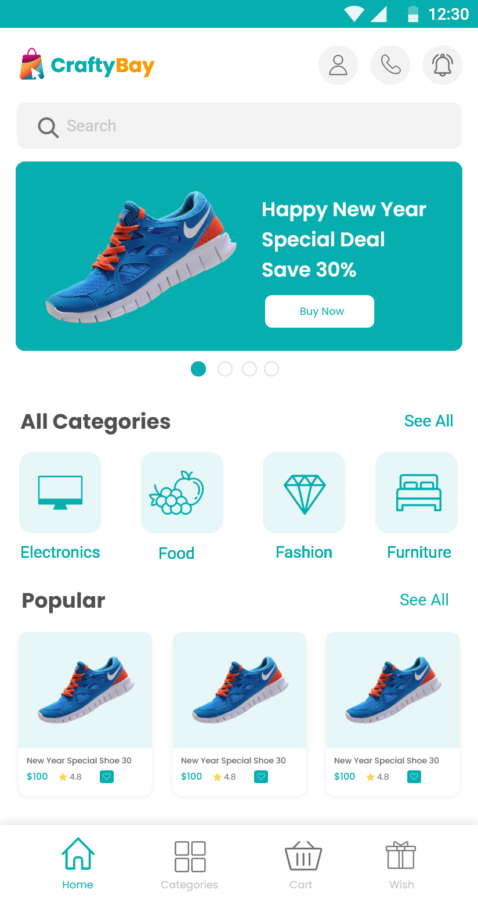
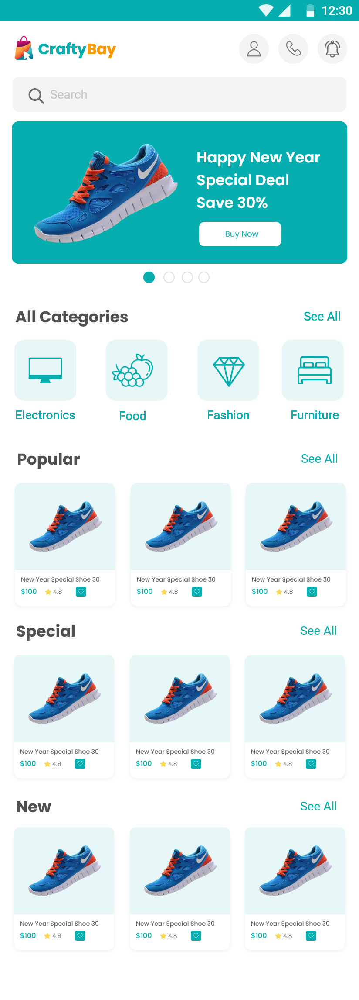
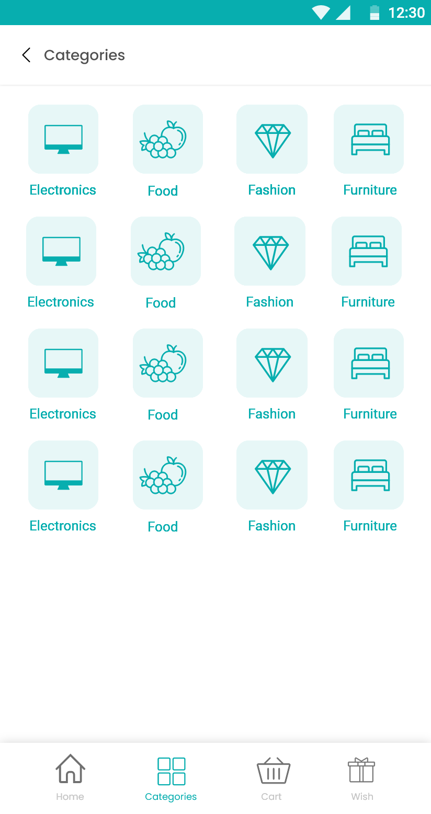
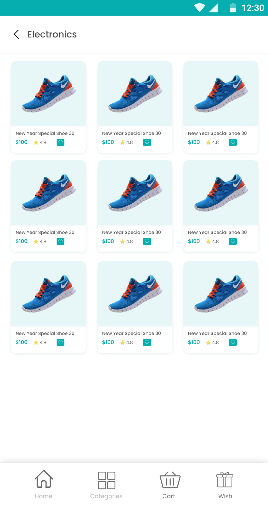
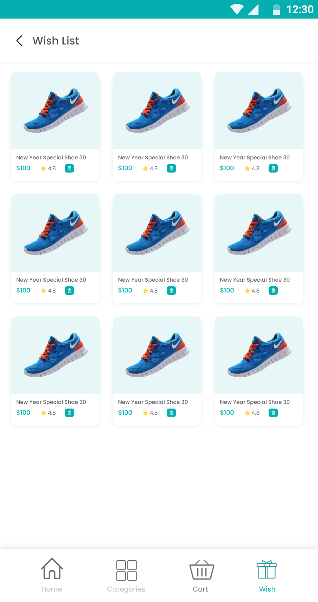
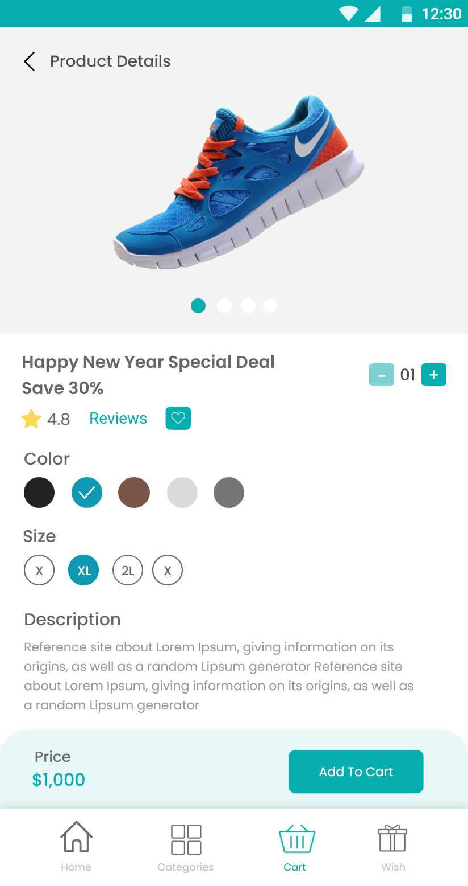
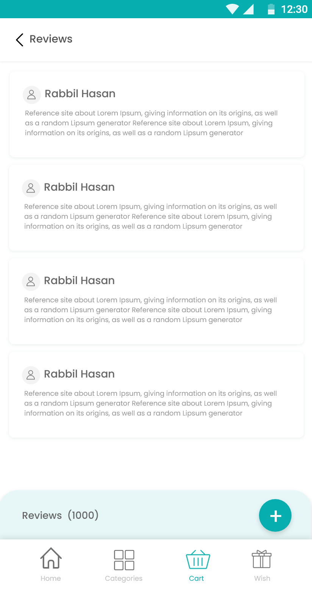

# 🛍️ CraftyBay - Full-Featured E-Commerce App

CraftyBay is a modern, responsive cross-platform e-commerce mobile application built with Flutter. It provides a seamless shopping experience for users, featuring user authentication, product catalog browsing, wishlist management, cart handling, and interactive review submission.

---

## 📱 App Screenshots & User Flow

### 1️⃣ Authentication & Security

| Welcome Screen | OTP Verification |
| :---: | :---: |
|  |  |

* **Feature & Purpose:** 
  * **Welcome Screen:** Allows users to initiate the login process by entering their registered email address.
  * **OTP Verification:** Enhances account security by requiring a 4-digit OTP code with a built-in expiration timer (120s) and resend feature.

---

### 2️⃣ Home & Category Browsing

| Home Page | Categories Screen | Category Products |
| :---: | :---: | :---: |
|  |  |  |

* **Feature & Purpose:**
  * **Home Page:** Features interactive promo banners, quick search bar, category shortcuts, and product lists (Popular, Special, New).
  * **Categories Screen:** Provides a clean grid layout for users to explore various shopping categories (Electronics, Food, Fashion, Furniture).
  * **Category Products:** Displays filtered items corresponding to a selected category with pricing, ratings, and favorite toggles.

---

### 3️⃣ Product Details & Wishlist Management

| Product Details | Wishlist Screen |
| :---: | :---: |
|  |  |

* **Feature & Purpose:**
  * **Product Details:** Shows detailed product info including image carousel, color and size selections, stock quantity counter, price display, and an "Add To Cart" button.
  * **Wishlist Screen:** Allows users to view and manage their saved items with options to quickly remove items.

---

### 4️⃣ Customer Reviews & Feedback

| Customer Reviews | Create Review |
| :---: | :---: |
|  |  |

* **Feature & Purpose:**
  * **Customer Reviews:** Displays all customer feedback and rating cards for a product, accompanied by an floating button to add new reviews.
  * **Create Review:** Enables customers to submit their first name, last name, and detailed text review for purchased products.

---

## ✨ Key Features

- **Responsive UI:** Optimized for all screen ratios including Android/Redmi devices and iOS.
- **State Management:** Clean architecture with efficient state management.
- **Dynamic Product Carousel:** High-resolution image sliders with indicator dots.
- **Cart & Wishlist Integration:** Real-time item count management and wishlist toggles.

---

## 🚀 Getting Started

### Prerequisites
- [Flutter SDK](https://docs.flutter.dev/get-started/install) installed on your machine.
- Android Studio / VS Code configured with Flutter plugins.

### Installation
1. Clone the repository:
   ```bash
   git clone [https://github.com/your-username/craftybay.git](https://github.com/your-username/craftybay.git)
